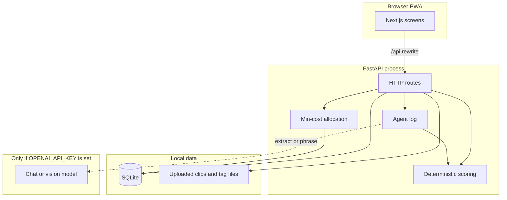
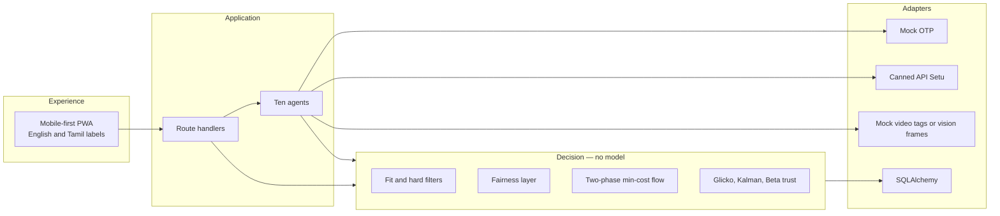
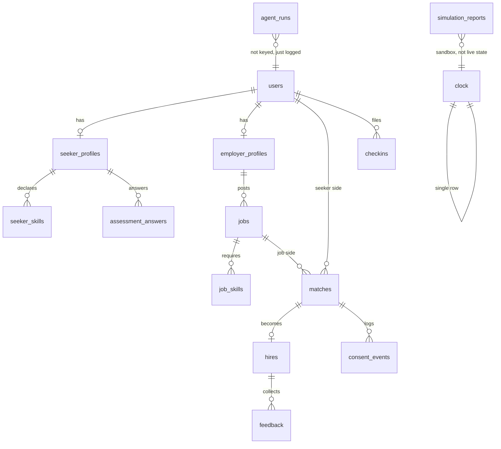
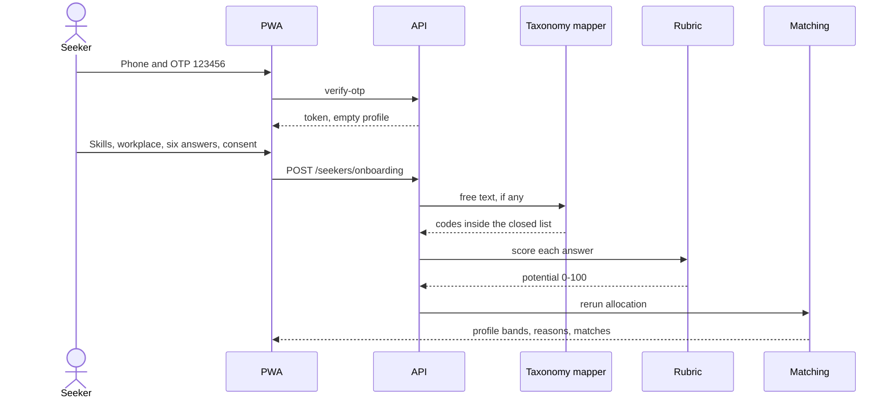
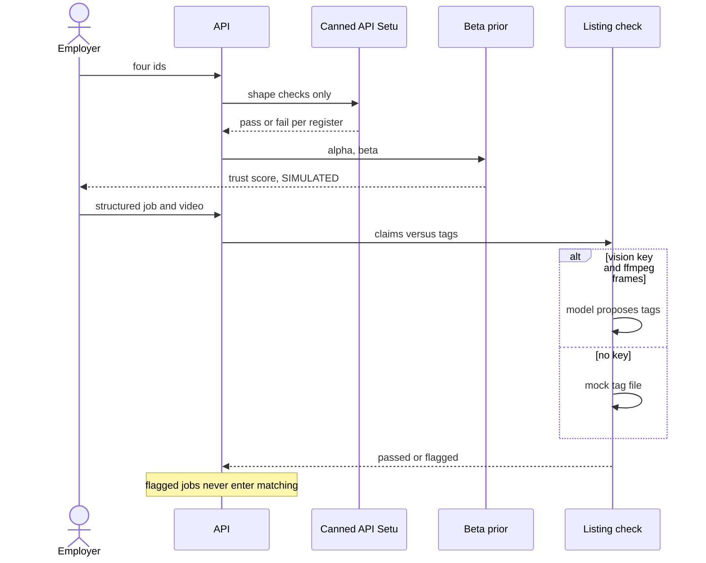
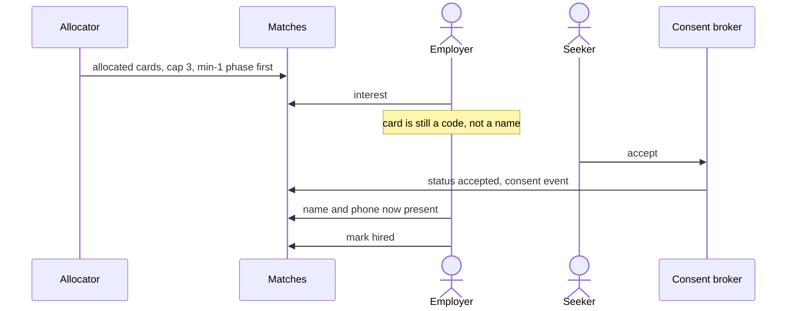
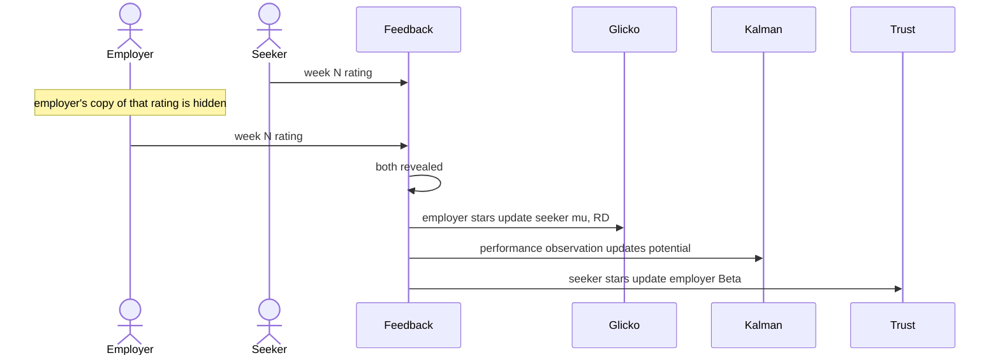
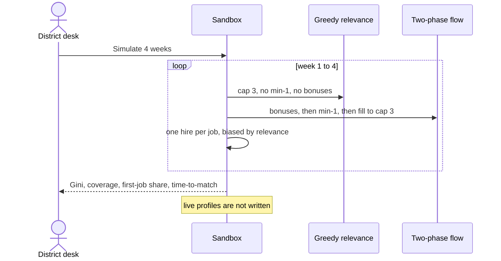

# KaamSetu — internal technical filing

Prototype for Tech4Bharat / GAVS 2026, problem 8.2: rural youth cannot find work that fits, and small employers cannot find them. This document is the source of truth for the code in this repository. Weights, thresholds, and mock rules below are the values the program actually uses. They are a basic model, chosen so a later pass can tune them without guessing what shipped.

The product boundary from the problem statement is kept: a listing is checked before it reaches a worker, and a worker's name and phone go to an employer only after the worker accepts.

## 1. System overview

KaamSetu is one web app and one API process.

- A seeker signs in with a mock OTP, builds a profile (skills, workplace preferences, six situational answers, consent), and sees a short list of openings with reasons.
- An employer passes four canned register checks, posts a structured job and a workplace video, and sees anonymous candidate cards. Interest, then the seeker's accept, then a hire.
- After a hire, both sides file a weekly checkpoint. The two ratings stay hidden until both exist. Skill, potential, and employer trust move only at that moment. The seeker can also check in once per simulated day.
- A district desk sees exposure, first-job share, time-to-match, and listings the video check flagged. A button replays four weeks of the seeded population under plain ranking and under the KaamSetu allocation. That replay does not rewrite stored profiles.

Agents plan and explain. They do not choose the number that ranks a person. Every score, filter, and seat is a Python function with a test.



## 2. Layered architecture



The experience layer never computes a score. The decision layer never calls a network. Adapters are the only place a fake external system or an optional model appears.

## 3. Modules

| Path | Responsibility |
| --- | --- |
| `frontend/app` | Screens: home, login, seeker, employer, district desk |
| `frontend/lib/i18n.tsx` | English and Tamil labels, session, catalogue cache |
| `frontend/lib/api.ts` | `fetch` with the bearer token from local storage |
| `frontend/components/ui` | Button, input, textarea, label, card, badge, switch |
| `backend/app/main.py` | FastAPI app and CORS |
| `backend/app/routers/api.py` | Every HTTP route |
| `backend/app/models.py` | Tables |
| `backend/app/catalog.py` | Ten Tamil Nadu districts, 18 skill codes, six questions |
| `backend/app/seed.py` | Deterministic synthetic district (`Random(42)`) |
| `backend/app/scoring/` | Pure functions. No database |
| `backend/app/services/matching_service.py` | Load rows, score pairs, write the allocation |
| `backend/app/services/feedback_service.py` | Clock, check-ins, double-blind reveal, score updates, badges |
| `backend/app/services/simulation.py` | Four-week sandbox, in memory |
| `backend/app/agents/` | Agent functions and the log |
| `backend/tests/test_scoring.py` | Rating, fit, fairness, caps, min-1, Gini, rubric |

Skill codes follow the shape of an NCO family code (`7533.01`) but the list is a prototype subset, not the official NCO-2015 catalogue.

## 4. Agents

The orchestrator is a dictionary of functions, not a graph runtime. `app/agents/orchestrator.py` calls the function and writes a row to `agent_runs` (`agent`, payload, result, `used_llm`). There is no hidden tool loop. A handler that needs a side effect either does it itself (matching) or returns a decision the route then stores (verification, consent).

| Agent | Module | Input | Output | Tools | Model |
| --- | --- | --- | --- | --- | --- |
| `voice_intake` | `agents/intake.py` | `message`, `lang` | Reply text, mapped skill codes | Taxonomy mapper | Optional rephrase. Facts stay inside the mapped codes |
| `taxonomy_mapper` | `agents/taxonomy.py` | Free text, level | Codes from the closed list | Keyword table in `catalog.py` | Optional extract. Any code not in the list is dropped |
| `assessment` | `agents/assessment.py` | Six answers | Per-question 0–5, potential 0–100, band | `scoring/rubric.py` | Optional gloss. The number is always the rubric |
| `listing_verification` | `agents/listing.py` | Structured claims, video path, mismatch flag | `passed` or `flagged`, field diffs | ffmpeg keyframes if a vision key is set; otherwise a mock tag file | Optional vision tags. The comparison is code |
| `employer_verification` | `agents/employer_verification.py` | Aadhaar, GSTIN, Udyam, EPFO id | Four canned checks, trust prior | None | Never |
| `matching` | `services/matching_service.py` | Simulated week | Counts of seats written | Fit, fairness, `allocate()` | Never |
| `consent_broker` | `agents/consent.py` | Match id, action | Whether identity is released | None. The route writes the row | Never |
| `feedback_retention` | `services/feedback_service.py` | Hire, week, stars, comment | Revealed flag, whether scores moved | Glicko, Kalman, Beta update | Never |
| `fairness_auditor` | `services/simulation.py` | Seed integer | Four-week report, both arms | Same allocator, two modes | Never |
| `explainer` | `agents/explainer.py` | A scored row or a profile | Up to three bilingual reasons | Templates keyed by the component that actually contributed | Never. A template cannot mention a bonus the formula did not add |

Voice is the browser Web Speech API filling a text box (`frontend/lib/utils.ts`, `listen`). The agent only sees text. If the browser has no speech API, the mic button is hidden.

## 5. HTTP API

Base path `/api`. Authenticated routes take `Authorization: Bearer <token>`. Errors are `{"detail": "..."}`.

The web app rewrites `/api/*` to `http://127.0.0.1:8421` (or `API_ORIGIN`).

### Health and catalogue

`GET /api/health`

```json
{"ok": true, "week": 2, "day": 2, "seekers": 200, "llm_configured": false, "otp": "mock"}
```

`GET /api/meta` returns districts (with latitude and longitude), the skill taxonomy, sectors, the six questions in English and Tamil, and the mock OTP.

### Sign-in

`POST /api/auth/request-otp`

```json
{"phone": "9840011101", "role": "seeker"}
```

```json
{"sent": true, "simulated": true, "phone": "9840011101", "hint": "123456"}
```

`POST /api/auth/verify-otp`

```json
{"phone": "9840011101", "otp": "123456", "role": "seeker", "name": "Priya Selvam", "district_id": "coimbatore"}
```

```json
{"token": "demo-seeker-token", "user": {"id": 26, "name": "Priya Selvam", "phone": "9840011101", "role": "seeker"}}
```

A wrong OTP is 400. A phone already used by another role is 409. `GET /api/auth/me` returns the same user object.

### Seeker

`GET /api/seekers/me` — profile, both bands, rating μ and RD, potential and velocity, bilingual reasons, badges, skills, answers, clock.

`POST /api/seekers/onboarding` — the wizard body (identity, environment, `skills: [{code, level}]`, optional `free_text_skill`, six `answers`). Runs the taxonomy mapper and the assessment, saves, then reruns the district allocation.

`POST /api/seekers/consent` `{"consent": false}` withdraws the seeker from future `allocated` rows. A hire already shared is not unshared.

`GET /api/seekers/matches` — job title, company, wage, environment, fit bars, reasons, status. No employer sees this payload; it is the seeker's own list.

`POST /api/seekers/matches/{id}/accept` — allowed from `interested`, and only if consent is on. Status becomes `accepted`.

`POST /api/seekers/matches/{id}/decline`

`POST /api/seekers/checkin` `{"mood": "good", "note": "Bus was on time."}` — one row per simulated day. Mood is `good`, `okay`, or `tough`.

`GET /api/seekers/hires` and `POST /api/seekers/feedback`

```json
{"hire_id": 1, "week": 2, "rating": 5, "comment": "The supervisor explains the stitch."}
```

The response includes `revealed`. Until the employer has filed the same week, their rating is omitted and the other side receives `"hidden": true`.

`POST /api/agents/intake` `{"message": "I can run a sewing machine", "lang": "en"}`

`POST /api/agents/map-skill` `{"text": "bike mechanic", "level": 3}`

### Employer

`GET /api/employers/me` — company, trust score and band, three reasons, the simulated verification payload, jobs.

`POST /api/employers/verify`

```json
{
  "aadhaar": "234123412341",
  "gstin": "33AABCU9603R1ZM",
  "udyam": "UDYAM-TN-07-0012345",
  "epfo_id": "CB/CBE/1234567"
}
```

The body of the response is labelled `"mode": "SIMULATED"` and includes a disclaimer that no government system was contacted. `verified` is true when at least two of the four checks pass. Trust is reset to the verification prior.

A failing sample is Aadhaar `900000000000`, GSTIN `33AABCU9603R1ZZ`, Udyam `NOT-A-UDYAM`, EPFO `BAD`.

`POST /api/jobs` is multipart. Fields mirror the seeker's workplace questions, plus salary, hike, perks, negotiation range, `open_to_freshers`, `will_train`, `openings`, `skills_json`, `demo_mismatch`, and an optional `video` file. Boolean fields are the strings `true` or `false`. The listing agent runs immediately. A flagged job is stored and kept off the seeker feed.

`GET /api/employers/jobs/{id}/candidates` — anonymous cards (`candidate_ref`, age band, district, skill bands, reasons). `name` and `phone` are present only when status is `accepted` or `hired`.

`POST /api/employers/matches/{id}/interest` — from `allocated` to `interested`.

`POST /api/employers/matches/{id}/hire` — only from `accepted`. Creates the hire and opens the checkpoint.

`GET /api/employers/hires` and `POST /api/employers/feedback` use the same body as the seeker checkpoint.

### District desk

All of these require the `official` role.

`GET /api/officials/overview` — clock, counts, Gini and exposure summary, first-job share of hires, mean allocation week, a row per district, flagged listings, and the latest simulation if one has been run.

`POST /api/officials/matching/run` — recompute `allocated` seats for the live district.

`POST /api/officials/clock/day` and `POST /api/officials/clock/week` — advance simulated time. A week advance inflates every skill RD, predicts every potential state, decays every employer toward their verification prior, and breaks a check-in streak if that week had no check-in.

`POST /api/officials/simulate` — four-week sandbox. Response label is `SIMULATED`.

`GET /api/agents/runs` — the latest 40 agent log rows.

`GET /api/files/{name}` — a stored clip. The name is reduced to a basename.

## 6. Data model



`matches.status` moves `allocated → interested → accepted → hired`, or `declined`. `accepted` and `hired` are the only states in which the employer card includes name and phone.

`feedback` is unique on `(hire_id, week, author_role)`. `revealed` and `scores_applied` start false.

`clock` is a single row: simulated week and day. The seeded district starts at week 2, day 2, with week-1 checkpoints already on file for the demo hire.

JSON documents (verification, video tags, reasons, badges) are stored as text so SQLite and Postgres share one schema. Set `KAAMSETU_DATABASE_URL` to a Postgres URL to switch engines; the models do not use SQLite-only types.

## 7. Flows

### 7.1 Seeker onboarding



### 7.2 Employer verification and listing



### 7.3 Matching and consent



### 7.4 Hire and feedback



### 7.5 Fairness simulation



## 8. Algorithms

### 8.1 Geography

`scoring/geo.py`. Ten district centres. The labour market of a district is that district plus its two nearest centres by haversine distance (earth radius 6371 km). A pair is in sector if the two sets intersect.

Same-district travel is treated as 8 km. Cross-district travel is the distance between centres.

### 8.2 Hard filters

`scoring/fit.py`, `passes_hard_filters`. A pair is dropped, not down-ranked, when any of these hold:

- consent is off, or onboarding is unfinished
- sectors do not overlap
- the job requires night work and the seeker has not opted in
- distance exceeds `max_commute_km` and the job does not provide lodging
- the listing is not `passed`, the job is not open, or no seat remains
- the employer is not verified

Shift, physical intensity, supervision, and team size are soft. They live in environment fit.

### 8.3 Relevance

All four components are in `[0, 1]`. Weights are the single mix, in `RELEVANCE_WEIGHTS`:

```
relevance = 0.40·SkillFit + 0.25·EnvFit + 0.20·PayFit + 0.15·Reliability
```

**SkillFit.** For each job skill, weight 2 if required and 1 if optional. A missing required skill contributes 0. A missing optional skill contributes 0.25. A held skill contributes `min(1, seeker_level / asked_level)`. The score is the weighted mean. An empty requirement list scores 0.5.

**EnvFit.** Mean of seven dimensions: shift (1 exact or `any`, 0.6 if either side is rotating, else 0.25), physical `1 - |Δ| / 4`, setting (1 equal, 0.9 if either side is `either`, else 0.35), lodging (0.25 if the seeker needs it and the job does not provide it, else 1), commute (1 if lodging is provided, else `max(0.5, 1 - 0.5·distance/max_km)`), supervision and team size (1 on match or `any`/`either`, else 0.55 and 0.65).

**PayFit.** Offered wage is the midpoint of the posted range. If it meets the expected wage, the base is 1. Otherwise it is `offered / expected`, plus 0.15 when the negotiation band covers the expected wage, or 0.10 when only the top of the band does. Perks add 0.03. Hike adds `min(0.05, hike_pct / 100 · 0.5)`. The total is capped at 1.

**Reliability.** `0.45·(1 - RD/350) + 0.35·min(streak, 10)/10 + 0.20·(1 if assessed else 0)`. A new seeker scores low here on purpose. The uncertainty bonus below is what keeps that from becoming a ban.

### 8.4 Fairness layer

`scoring/fairness.py`. Added after relevance. Never applied to a pair a hard filter already removed. Defaults, overridable by environment variables:

| Term | Formula | Default cap | When it is zero |
| --- | --- | --- | --- |
| Uncertainty | `cap · min(RD, 350) / 350` | 0.08 | RD is 0 |
| Exposure | `cap · max(0, (median - exposure) / median)` | 0.10 | Exposure is at or above the district median |
| Potential | `cap · potential/100` | 0.12 | The job's `will_train` is false |
| First job | flat | 0.04 | The seeker worked before, or already holds a live hire |

```
final = relevance + uncertainty + exposure + potential + first_job
```

`final` is not clipped. A theoretical ceiling is about 1.34, and the allocator's cost offset assumes the score stays under 1.5. The card shows the three fit bars from the components, and a reason only if that term is at least 0.015 (or the fit component is strong: skill ≥ 0.55, environment ≥ 0.60, pay ≥ 0.75, reliability ≥ 0.45). The top three by contribution are kept.

The potential term is the one the product has to be able to defend: it is a training bet. It does not lift a seeker on a job that expects someone who can already do the work.

### 8.5 Allocation

`scoring/allocate.py`, using `networkx.max_flow_min_cost`.

Seeker cap is 3 (`KAAMSETU_SEEKER_CAP`). Seats already in `interested`, `accepted`, or `hired` reduce both the job's remaining openings and that seeker's remaining cap.

Edge cost is `round((1.5 - score) · 1000)`, so a better score is a cheaper edge. Source and sink edges cost 0.

**KaamSetu mode, two phases.**

1. Every seeker who still has a free slot is given capacity 1. Maximum flow of minimum cost. This is the min-1 guarantee: nobody receives a second opening while someone with a feasible job has none, subject to seats and geography.
2. Job seats and seeker caps are reduced by phase 1. A second flow fills each seeker up to the remaining cap (2, if the cap is 3 and phase 1 used a seat).

**Ranking mode**, used only inside the sandbox. One greedy pass on raw relevance. The same caps apply, but the highest scores take a seeker's full cap before a later seeker is considered. There is no min-1 phase and the fairness terms are not in the sort key.

A seeker with no feasible edge is left unmatched. The guarantee is best-effort against supply and geography, which the coverage metric reports.

### 8.6 Skill rating (Glicko-1)

`scoring/glicko.py`. One observation at a time, Glickman 1999. `q = ln(10) / 400`.

```
g(RD) = 1 / sqrt(1 + 3 q² RD² / π²)
E = 1 / (1 + 10^(-g(RD_opp) · (μ - μ_opp) / 400))
d² = 1 / (q² g(RD_opp)² E (1-E))
μ' = μ + (q / (1/RD² + 1/d²)) · g(RD_opp) · (s - E)
RD' = sqrt(1 / (1/RD² + 1/d²))
```

Stars map to `s` as 1→0, 2→0.25, 3→0.5, 4→0.75, 5→1. The opponent is a role benchmark: `μ_opp = 1400 + 80·min_level`, `RD_opp = 70`, where `min_level` is the hardest required skill on the job (1–5).

Idle weeks inflate RD before the next display, on the week-advance button:

```
RD ← min(sqrt(RD² + c² · weeks), 350)    c = 30
```

The band uses the conservative value `μ - RD`: High ≥ 1550, Medium ≥ 1400, else Building. The number on the profile is a display index `(μ - 1200) / 6`, clamped to 0–100. A new profile starts at μ 1500, RD 350; the seed draws a spread so the district is not uniform.

### 8.7 Potential (Kalman)

`scoring/kalman.py`. State is level `p` (0–100) and weekly velocity `v`.

```
F = [[1, 1], [0, 1]]
Q = diag(1.0, 0.25)
H = [1, 0]
R = 16
```

Predict on each simulated week: `p ← p + v`, then `P ← F P Fᵀ + Q`. Update when a checkpoint is revealed. The first update does not move velocity, because the prior cross-covariance is zero. After one predict, level and velocity are coupled, so the next observation can pull the trend.

Initial covariance is `diag(36, 1)`. Level starts at the rubric score. Velocity starts at 0. Level is clamped to 0–100 and velocity to ±5.

The observation is `rating/5·100` if there were no check-ins that hire week, otherwise `0.75·rating score + 0.25·(good check-ins / check-ins)·100`.

The rubric (`scoring/rubric.py`) scores each answer 0–5 from keyword stems in English and Tamil, plus one point for an answer of at least 40 characters. An answer under 8 characters is 0. Potential is `100 · sum(scores) / (5 · N)`. Band: High ≥ 75, Medium ≥ 50, else Building.

### 8.8 Employer trust

`scoring/trust.py`. A Beta posterior. The mean `100 · α / (α + β)` is the score. Band: High ≥ 75, Medium ≥ 55, else Building.

Verification prior starts at Beta(2, 2), then:

| Check | Pass adds to α | Fail adds to β |
| --- | --- | --- |
| Aadhaar e-KYC | 2.0 | 1.5 |
| GST | 2.0 | 1.5 |
| Udyam | 1.5 | 0.8 |
| EPFO | 1.5 | 0.8 |

A passed listing adds 0.4 to α. A flagged listing adds 0.8 to β. A weekly seeker rating adds 1 to α if stars ≥ 4, 1 to β if stars ≤ 2, and 0.35 to each if the rating is 3.

Each simulated week decays toward the verification prior `(α0, β0)`:

```
α ← α0 + (α - α0) · e^(-λ)     λ = 0.15
```

and the same for β. Old praise does not last forever. A failed register check keeps pulling the score back down.

### 8.9 Sandbox metrics

`scoring/metrics.py` and `services/simulation.py`.

Gini of exposure, share with zero recommendations, share with at least one, mean weeks until the first recommendation, first-time share among simulated hires, mean relevance of assignments, and the share of high-potential first-time seekers (potential ≥ 75) who were shown at least one `will_train` job.

Each arm hires at most one allocated candidate per job per week. The hire probability is `0.35 + 0.5·relevance` of the best allocated candidate, drawn from `Random(seed)` with a one-step offset between arms so the two worlds are not the same coin flips. Openings decrease. A hired person is no longer "first time" the next week. Exposure is fed back into the fairness terms of the KaamSetu arm only.

On the seeded district this comparison is large enough to read: exposure Gini about 0.63 versus 0.33, seekers reached at least once about 58% versus 92%, first-time share of hires about 15% versus 30%. Those figures move if the seed changes. The screen prints the numbers it just computed, not a pasted target.

### 8.10 Badges

Awarded in `feedback_service.award_for_events`, once each: profile ready, assessment done, first recommendation, five check-ins, hired, rising potential (velocity > 0.4), trusted skill (`μ - RD ≥ 1550`).

## 9. What is real, and what is mocked

| Piece | In this prototype |
| --- | --- |
| Fit math, Glicko, Kalman, Beta trust, Gini | Real code, tested |
| Min-cost allocation and the ranking comparison | Real `networkx` flow |
| Tamil / English labels, six questions, consent gate | Real UI and real rows |
| Synthetic district of ~200 seekers and ~60 jobs | Generated, `Random(42)`, labelled SIMULATED on the desk |
| OTP | Mock. The code is always `123456`. No SMS |
| API Setu (Aadhaar e-KYC, GST, Udyam, EPFO) | Canned shape checks. No government host is called |
| Workplace video | The file is stored. Without a vision key, tags are a deterministic mock file, and a checkbox can force a disagreement. With `OPENAI_API_KEY` and ffmpeg, up to three frames are sent and the model's tags are compared by the same checker |
| Language model | Off unless `OPENAI_API_KEY` is set. Used to phrase intake, extract a skill code, gloss an assessment, or tag frames. Scores ignore it |
| Voice | Browser speech-to-text only, when the device has it |
| Clock | A week and a day integer. Buttons on the district desk move it |
| Photo | Initials placeholder. No upload |
| Auth | Bearer token in local storage. No password, no session server |

## 10. Configuration

| Variable | Default | Effect |
| --- | --- | --- |
| `KAAMSETU_DATABASE_URL` | `sqlite:///backend/data/kaamsetu.sqlite` | Engine URL |
| `KAAMSETU_MOCK_OTP` | `123456` | The only accepted OTP |
| `KAAMSETU_PORT` | `8421` | API port |
| `KAAMSETU_WEB_PORT` | `4317` | Set by `dev.sh` for Next.js |
| `API_ORIGIN` | `http://127.0.0.1:8421` | Where Next rewrites `/api` |
| `OPENAI_API_KEY` | empty | Turns on optional model calls |
| `OPENAI_BASE_URL` | `https://api.openai.com/v1` | Compatible endpoints can be pointed here |
| `OPENAI_MODEL` | `gpt-4o-mini` | Text calls |
| `OPENAI_VISION_MODEL` | same as text model | Frame tags |
| `KAAMSETU_SEEKER_CAP` | `3` | Maximum live recommendations per seeker |
| `KAAMSETU_FAIR_UNCERTAINTY_MAX` | `0.08` | |
| `KAAMSETU_FAIR_EXPOSURE_MAX` | `0.10` | |
| `KAAMSETU_FAIR_POTENTIAL_MAX` | `0.12` | Applied only when `will_train` |
| `KAAMSETU_FAIR_FIRST_TIME` | `0.04` | |
| `KAAMSETU_GLICKO_C` | `30` | RD growth per idle week |
| `KAAMSETU_GLICKO_RD_MAX` | `350` | |
| `KAAMSETU_TRUST_DECAY` | `0.15` | Weekly λ |

## 11. How to run

```bash
./dev.sh          # API :8421 and web :4317, seeds on first launch
./dev.sh test     # pytest for scoring and allocation
./dev.sh --reset  # drop and rebuild the synthetic district
```

Sign in with the phones in the README. The district desk's **Simulate 4 weeks** button is the comparison. **Advance 1 week** is the only thing that ages ratings.

Tests do not touch the database. They import the scoring modules directly:

```bash
cd backend && .venv/bin/pytest -q
```

## 12. Cost and overhead

With no API key the running cost is one Python process, one Node process, and a SQLite file. A full allocation of this seed is about 2,500 feasible edges and returns in well under a second. The four-week sandbox is the same order of magnitude; it does not call a model and does not write seeker rows.

An optional model call is one chat completion per intake message, per free-text skill map, and per finished assessment, plus one vision call (up to three frames) per uploaded listing. Failures fall back to the deterministic path. There is no retry loop and no agent that spends tokens deciding a rank.

The PWA caches nothing important. The service worker claims the client and then lets every request hit the network.

## 13. Shortcuts, on purpose

- SQLite instead of Postgres. The URL is the switch.
- A function registry instead of LangGraph. The ten agents and their inputs are the same shape either way; there is no checkpointed graph.
- `networkx` instead of OR-Tools. The flow is small. OR-Tools is the right swap when side constraints (quotas per community, per gender, per ITI) stop fitting a plain capacity.
- Glicko-1, not Glicko-2. There is no volatility σ.
- The Kalman filter is a two-state constant-velocity model with hand-set noise, not a fitted one.
- Fairness weights are constants, not learned from who stays in the job.
- The video check without a key does not look at pixels. It compares the job's structured fields to a tag file. The mismatch switch exists so a demo can show a flag.
- API Setu rules are regular expressions plus one deliberate fail pattern. They are not the production verification API.
- One process, no queue, no audit ledger beyond `agent_runs` and `consent_events`.
- Onboarding reruns the whole allocation, which can reshuffle other people's `allocated` cards. In-progress interest, accept, and hire rows are kept.
- Exposure counts recommendations ever issued. It does not decrease when a card is later removed.
- Copy beyond the key labels is still English in several explanations. Reasons from the API are stored in both languages.
- The skill list is eighteen codes. It will not survive contact with a real employer survey.
- Auth is a bearer token in local storage. Do not put this on a public host as-is.

## 14. Optimisation backlog

1. Replace the eighteen codes with a maintained NCO (or NOS) subset, and keep the mapper's closed-list rule.
2. Learn environment and wage weights from 90-day retention, with the hard filters left as policy rather than as fitted features.
3. Move the allocator to a solver that can hold a minimum share for first-time workers inside each district, not only a bonus on the edge.
4. Glicko-2, or a simpler Bayesian skill model, once checkpoint volume exists. Publish the conservative band (`μ - RD` or a lower credible bound) rather than the point rating.
5. Fit the Kalman noise on real monthly performance, or drop the filter if the rubric-plus-checkpoint average is clearer to a seeker.
6. A real listing check: sample frames, a fixed tag schema, a human review queue for flags. Do not auto-reject on a single model disagreement.
7. Sandbox credentials for API Setu, with the simulated banner removed only when the host is real.
8. Consent as a versioned grant: which fields, which employer, when it expires, and a withdrawal that the employer can see.
9. Postgres, and a district id that is a boundary rather than a city centre. Commute should be road time, not haversine between headquarters.
10. LangGraph or an equivalent only if a multi-step case (a failed listing, a missing document, a seeker who goes quiet) needs durable state. Do not put the ranker inside the graph.
11. Exposure as an online budget: a seeker who has been shown enough good jobs stops receiving the deficit bonus.
12. An immutable event log for interest, reveal, hire, and score changes, separate from the current-state tables.
13. Sit with ITI students and small unit owners and rewrite the six questions. The current rubric is a keyword stand-in, not an instrument.
14. Accessible Tamil voice that does not depend on a desktop browser's speech API, and a low-bandwidth path that does not assume a 2 MB clip upload.

## 15. Screenshots

| File | Screen |
| --- | --- |
| `docs/screenshots/01-home.png` | Role picker |
| `docs/screenshots/02-login-seeker.png` | Mock OTP sign-in |
| `docs/screenshots/03-seeker-matches.png` | Seeker's openings, including accept |
| `docs/screenshots/04-seeker-profile.png` | Scores, reasons, badges |
| `docs/screenshots/05-seeker-profile-tamil.png` | Same profile with Tamil labels |
| `docs/screenshots/06-seeker-onboarding.png` | First onboarding step |
| `docs/screenshots/07-seeker-week.png` | Check-in and revealed week-1 checkpoint |
| `docs/screenshots/08-seeker-chat.png` | Intake chat |
| `docs/screenshots/09-employer-trust.png` | Trust score and listings, one flagged |
| `docs/screenshots/10-employer-verify.png` | Simulated API Setu form |
| `docs/screenshots/11-employer-new-job.png` | Structured job, same environment fields |
| `docs/screenshots/12-employer-candidates.png` | Anonymous cards, Priya revealed because hired |
| `docs/screenshots/13-employer-interest-waiting.png` | Interest sent, waiting on the seeker |
| `docs/screenshots/14-employer-hires.png` | Double-blind checkpoint |
| `docs/screenshots/15-officials-dashboard.png` | District metrics and the four-week comparison |
